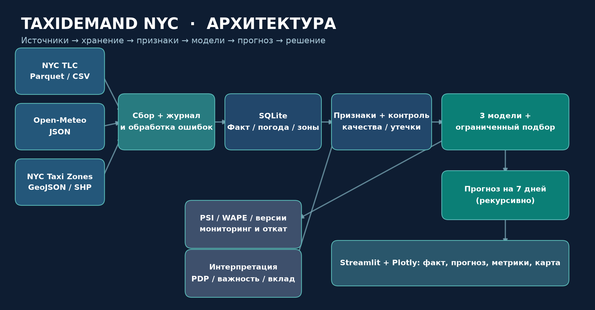
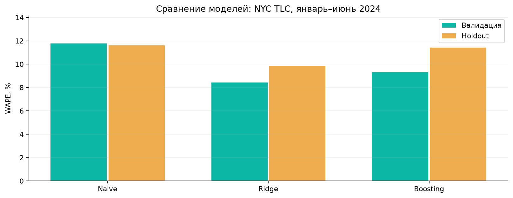

# TaxiDemand NYC — прогнозирование спроса на такси

Проект по дисциплине **«Проектный практикум»**, вариант №16 — «Городской трафик и такси. Спрос на поездки по районам города».

**TaxiDemand NYC** — система анализа и прогнозирования количества поездок жёлтого такси по географическим зонам Нью-Йорка. Проект реализует полный цикл работы с данными: загрузку из открытых источников, обработку, построение признаков, обучение моделей машинного обучения, прогнозирование, визуализацию и мониторинг качества.

Основной эксперимент проведён на **реальных данных за январь–июнь 2024 года**.

## 1. Возможности проекта

- Загрузка данных NYC TLC, Open-Meteo и NYC Taxi Zones.
- Инкрементальное и идемпотентное обновление данных.
- Хранение данных в SQLite.
- Проверка качества данных, пропусков и дубликатов.
- Формирование временных, календарных и погодных признаков.
- Защита от утечки информации из будущего.
- Обучение и сравнение трёх прогнозных моделей.
- Хронологическое разделение на train, validation и holdout.
- Прогнозирование спроса на 7 дней.
- Интерактивный дашборд на Streamlit и Plotly.
- Интерпретация моделей и анализ важности признаков.
- Мониторинг качества и дрейфа данных с помощью WAPE и PSI.
- Реестр версий моделей и возможность отката.
- Журнал экспериментов и воспроизведение результатов.
- Автоматические тесты.
- Автономный демонстрационный режим на синтетических данных.

## 2. Используемые данные

Проект объединяет три открытых источника.

| Источник | Формат | Назначение |
|---|---|---|
| NYC TLC Yellow Taxi | Parquet | История поездок и количество посадок |
| Open-Meteo Historical Weather | JSON | Температура, осадки и ветер |
| NYC Taxi Zones | GeoJSON / SHP / CSV | Географические зоны и их характеристики |

### NYC TLC Yellow Taxi

Основной источник — открытые записи о поездках жёлтых такси Нью-Йорка.

Для эксперимента загружены шесть ежемесячных файлов за период **01.01.2024–30.06.2024**.

Поездки агрегируются по дате и идентификатору зоны посадки (`PULocationID`). Целевая переменная — количество начавшихся поездок за сутки в конкретной зоне.

Источник: https://www.nyc.gov/site/tlc/about/tlc-trip-record-data.page

### Open-Meteo

Исторические погодные данные за тот же период: температура, осадки и скорость ветра.

Для предотвращения утечки информации модель использует погодные признаки предыдущего дня.

Источник: https://open-meteo.com/en/docs/historical-weather-api

### NYC Taxi Zones

Географический справочник зон такси, содержащий идентификаторы, названия, Borough и границы районов.

Источник: https://data.cityofnewyork.us/d/8meu-9t5y

### Объём данных

| Показатель | Значение |
|---|---:|
| Период | Январь–июнь 2024 |
| Календарных дней | 182 |
| Зон в справочнике | 260 |
| Суточных записей поездок | 41 460 |
| Зон для моделирования | 30 |
| Прогнозный горизонт | 7 дней |

Проверка SQLite не выявила дублирующихся ключей в таблицах `trips`, `weather` и `zones`.

## 3. Архитектура



Основной конвейер:

1. **Сбор данных:** загрузка Parquet, JSON и географических файлов.
2. **Хранение:** сохранение исходных файлов, суточных агрегатов и журналов.
3. **Обработка:** очистка, формирование календарной сетки и контроль качества.
4. **Feature Engineering:** создание лаговых, скользящих, календарных и погодных признаков.
5. **Machine Learning:** обучение, подбор параметров и сравнение моделей.
6. **Прогноз:** рекурсивное прогнозирование на семь дней.
7. **Аналитика:** отображение результатов в Streamlit.
8. **Мониторинг:** контроль ошибок, дрейфа и версий моделей.

### Технологический стек

- Python 3.11–3.13
- pandas, NumPy, PyArrow
- scikit-learn
- SQLite
- Requests
- Streamlit, Plotly
- Matplotlib
- joblib
- pytest
- Docker, Docker Compose

## 4. Установка и запуск

### Требования

- Python 3.11–3.13
- pip
- Git
- Доступ к интернету для загрузки реальных данных

Проект можно запускать в Linux или WSL Ubuntu.

### Клонирование

```bash
git clone https://github.com/Casablancawastaken/taxi-demand-nyc.git
cd taxi-demand-nyc
```

### Виртуальное окружение

```bash
python3 -m venv .venv
source .venv/bin/activate
python -m pip install -r requirements.txt
```

### Загрузка реальных данных

```bash
python -m taxi.cli reset
python -m taxi.cli sync --start 2024-01 --months 6
```

Команда `sync` загружает данные NYC TLC за шесть месяцев, историческую погоду и справочник геозон.

Повторная синхронизация поддерживает идемпотентную обработку данных.

### Обучение моделей

```bash
python -m taxi.cli train
```

### Прогноз на 7 дней

```bash
python -m taxi.cli forecast --days 7
```

### Мониторинг

```bash
python -m taxi.cli monitor
```

### Запуск веб-интерфейса

```bash
streamlit run app.py
```

После запуска Streamlit выведет адрес приложения. При использовании WSL может потребоваться открыть приложение по IP-адресу WSL.

### Автономный демонстрационный режим

Для проверки без загрузки реальных данных предусмотрен отдельный режим:

```bash
python -m taxi.cli demo --reset
python -m taxi.cli train
python -m taxi.cli forecast --days 7
streamlit run app.py
```

**Важно:** демонстрационный режим использует синтетические данные. Его метрики не следует интерпретировать как результаты на реальных поездках NYC TLC.

## 5. Формирование признаков

Для прогнозирования используются 21 исходный признак, включая:

- Идентификатор зоны и Borough.
- День недели, месяц и число месяца.
- Признак выходного дня.
- Циклическое кодирование календарных признаков.
- Лаги спроса: 1, 7, 14 и 28 дней.
- Скользящие средние за 7 и 28 дней.
- Стандартное отклонение и минимум за 7 дней.
- Температуру, осадки и ветер предыдущего дня.

Для даты `t` признаки спроса рассчитываются исключительно из предыдущих наблюдений.

Например:

`lag_7(t) = y(t - 7)`

Такой подход исключает использование целевого значения прогнозируемого дня при формировании признаков.

## 6. Модели машинного обучения

В проекте сравниваются три подхода:

1. **SeasonalNaive** — базовый сезонный прогноз по аналогичному дню предыдущей недели.
2. **Ridge** — линейная регрессия с L2-регуляризацией.
3. **HistGradientBoostingRegressor** — градиентный бустинг на деревьях решений.

Для обучения используется хронологическое разделение данных без случайного перемешивания.

| Выборка | Период |
|---|---|
| Train | 29.01.2024–29.04.2024 |
| Validation | 30.04.2024–30.05.2024 |
| Holdout | 31.05.2024–30.06.2024 |

Модель выбирается по WAPE на validation. Holdout используется для независимой финальной оценки.

Random seed: `42`.

## 7. Результаты эксперимента

Результаты обучения на реальных данных NYC TLC:

| Модель | WAPE validation | MAE holdout | RMSE holdout | WAPE holdout |
|---|---:|---:|---:|---:|
| SeasonalNaive | 11,77% | 357,46 | 531,67 | 11,61% |
| **Ridge** | **8,42%** | **303,09** | **418,40** | **9,85%** |
| HistGradientBoosting | 9,30% | 351,70 | 492,67 | 11,43% |



**Лучшая модель — Ridge.**

Она показала наименьшую WAPE на validation и holdout среди трёх рассмотренных моделей.

Метрики:

- **MAE** — средняя абсолютная ошибка количества поездок.
- **RMSE** — среднеквадратичная ошибка с повышенным штрафом за большие отклонения.
- **WAPE** — суммарная абсолютная ошибка относительно фактического объёма спроса.

На holdout Ridge получила WAPE **9,85%**.

## 8. Прогнозирование

Прогноз формируется на семь дней после последней даты доступных данных.

Для эксперимента с историей до 30.06.2024 прогнозный период начинается с 01.07.2024.

Прогноз строится для 30 зон:

`30 зон × 7 дней = 210 прогнозных записей`.

Применяется рекурсивный подход: предсказанные значения предыдущих дней используются для формирования лагов последующих дней.

При отсутствии будущего прогноза погоды используется последнее доступное погодное наблюдение.

## 9. Интерпретируемость

Для объяснения работы модели реализованы:

- Permutation Importance — изменение ошибки при перемешивании признака.
- Ablation Importance — исключение признака с повторным обучением.
- Partial Dependence Plot — зависимость предсказания от выбранного признака.
- Сравнение важности признаков между временными периодами.
- Локальная декомпозиция отдельного прогноза.

Среди значимых признаков спроса выделяются лаги `lag_7`, `lag_28`, `lag_14` и скользящее среднее за 28 дней.

## 10. Мониторинг и управление моделями

Реализован контроль качества прогнозирования и изменения распределений признаков.

Основные показатели:

- WAPE по последним известным фактическим данным.
- PSI для контроля дрейфа признаков.
- Рекомендация переобучения при превышении порогов.

Выполнена проверка обычного режима мониторинга и искусственно смоделированного дрейфа.

### Команды

```bash
python -m taxi.cli monitor
python -m taxi.cli monitor --simulate-drift
python -m taxi.cli registry
```

Реализован реестр версий моделей с возможностью ручного отката.

Для восстановления определённой версии:

```bash
python -m taxi.cli rollback VERSION
```

Для воспроизведения эксперимента:

```bash
python -m taxi.cli reproduce EXPERIMENT_ID
```

В ходе проверки воспроизведённая WAPE совпала с исходным результатом.

## 11. Автоматическое тестирование

Запуск:

```bash
python -m pytest -q
```

**Результат проверки: 7 passed.**

Тестируются основные компоненты конвейера, включая обработку данных, защиту от утечки, хронологию валидации, обучение, прогнозирование и воспроизводимость.

## 12. Структура проекта

```text
taxi-demand-nyc/
├── app.py
├── taxi/
│   ├── cli.py
│   ├── db.py
│   ├── features.py
│   ├── interpret.py
│   ├── modeling.py
│   ├── monitoring.py
│   ├── settings.py
│   └── sources.py
├── tests/
│   └── test_pipeline.py
├── docs/
│   ├── architecture.md
│   ├── architecture.png
│   ├── build_materials.py
│   ├── metrics_comparison.png
│   ├── Отчет_Вариант16.docx
│   ├── Отчет_Вариант16.pdf
│   ├── Презентация_Вариант16.pptx
│   └── Презентация_Вариант16.pdf
├── artifacts/
├── data/
├── outputs/
├── Dockerfile
├── docker-compose.yml
├── Makefile
├── requirements.txt
├── requirements-docs.txt
└── README.md
```

Исходные большие датасеты и SQLite исключены из Git. Обученные модели и JSON-манифесты экспериментов сохранены в `artifacts/`.

Для полноценного запуска после клонирования необходимо восстановить исходные данные, SQLite и состояние реестра посредством команд загрузки и обучения.

## 13. Ограничения

- Исследование охватывает только жёлтые такси NYC TLC.
- Используются исторические данные за шесть месяцев 2024 года.
- Для моделирования выбраны 30 зон.
- Погодные наблюдения не учитывают локальные различия между всеми районами.
- Будущие погодные условия аппроксимируются последним известным наблюдением.
- Ошибка рекурсивного семидневного прогноза может отличаться от ошибки на holdout.
- Прототип предназначен для исследования и демонстрации, а не для промышленной диспетчеризации.

## 14. Документация

В директории `docs/` находятся:

- Архитектура системы.
- Сценарий демонстрации.
- Отчёт о проектной работе в DOCX и PDF.
- Презентация в PPTX и PDF.
- Генератор документов и графиков.

## 15. Итог

Разработан работающий прототип системы прогнозирования спроса на такси по районам Нью-Йорка.

На реальных данных проведены загрузка, обработка, обучение и сравнение трёх моделей. Лучший результат показала **Ridge с WAPE 9,85%** на независимой отложенной выборке.

Дополнительно реализованы интерактивная аналитика, интерпретация, мониторинг дрейфа, версионирование моделей и воспроизводимость экспериментов.
