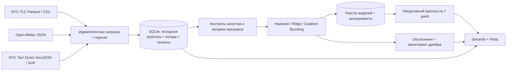

# TaxiDemand NYC — проектный практикум, вариант №16

**Тема:** «Городской трафик и такси. Спрос на поездки по районам города».  
**Цель:** спрогнозировать число начинающихся поездок жёлтого такси в сутки по зонам NYC TLC и поддержать решение о распределении машин.  
**Пользователь:** диспетчер таксопарка, городской аналитик.  
**Тип прогноза:** количество поездок за календарные сутки, по `PULocationID` (зона отправления), горизонт 7 дней после последнего имеющегося факта.

Проект собран по методическим указаниям «Проектный практикум» (8 страниц), включая основные компоненты, интерпретируемость, мониторинг и журнал экспериментов. **Сейчас в архиве сохранён рабочий демонстрационный пример только на СИНТЕТИЧЕСКИХ данных.** Реальные поездки не встроены в архив, но предусмотрена загрузка из публичных источников.

## 1. Быстрый запуск на Windows + WSL Ubuntu

Требования: Python **3.11–3.13**, pip, доступ к интернету для установки библиотек; запуск дашборда — на машине с браузером. Рекомендуется виртуальная среда.

```bash
unzip taxi_demand_project.zip
cd taxi_demand_project
python3 -m venv .venv
source .venv/bin/activate
python -m pip install -r requirements.txt
streamlit run app.py
```

Открыть в браузере адрес, напечатанный Streamlit (обычно `http://localhost:8501`). **Демо-база и обученная модель уже включены в архив.** Если в другом окружении возникает ошибка несовместимой версии модели, выполнить приведённые ниже команды переобучения.

В терминале из папки проекта полный цикл можно повторить так:

```bash
python -m taxi.cli demo --reset
python -m taxi.cli train
python -m taxi.cli forecast --days 7
python -m taxi.cli monitor
python -m pytest -q
streamlit run app.py
```

Выполнение всей демонстрационной цепочки одной командой:

```bash
make all
```

В PowerShell вместо `source .venv/bin/activate` использовать `.venv\Scripts\Activate.ps1`, а вместо `python3` — `python`.

## 2. Загрузка настоящих данных

Сначала удалить старые результаты деморежима **из базы**, затем запросить реальные источники:

```bash
python -m taxi.cli reset
python -m taxi.cli sync --start 2024-01 --months 6
python -m taxi.cli train
python -m taxi.cli forecast --days 7
python -m taxi.cli monitor
streamlit run app.py
```

Загрузка шести месяцев поездок — **сотни мегабайт**; первый запуск требует подключения к интернету и места на диске. Прямое скачивание публичных файлов в среде подготовки данного архива было недоступно, поэтому реальный режим **реализован в коде, но сетевое интеграционное тестирование не пройдено**. Для защиты рекомендуется выполнить этот сценарий локально и проверить журнал загрузок. В проекте не используются персональные данные.

После первоначальной загрузки можно догружать новые месяцы без повторного импорта:

```bash
python -m taxi.cli sync --start 2024-07 --months 3
python -m taxi.cli train
python -m taxi.cli forecast
```

Повтор того же `sync` помечает уже загруженные месяцы `SKIPPED` и не дублирует записи. Не смешивать демо- и реальный режимы: перед переходом выполнять `reset`. Команда `train` для неизменившегося набора данных переиспользует эксперимент (или можно явно указать `train --force`).

Источники:

1. [NYC TLC — Yellow Taxi Trip Records](https://www.nyc.gov/site/tlc/about/tlc-trip-record-data.page): ежемесячные Parquet-файлы с временем подачи такси и `PULocationID`.
2. [Open-Meteo — Historical Weather API](https://open-meteo.com/en/docs/historical-weather-api): суточные температура, осадки, максимальный ветер в Нью-Йорке; формат JSON.
3. [NYC Open Data — NYC Taxi Zones](https://data.cityofnewyork.us/d/8meu-9t5y): геометрии районов GeoJSON. Если API не отдал ожидаемый формат, загружается официальный shapefile NYC TLC; справочник названий — CSV TLC.

Месячные записи TLC могут публиковаться с задержкой. Прогноз строится **от последней загруженной даты**, а не автоматически на сегодняшнюю дату. Модель жёлтого такси не равна прогнозу всего рынка такси и Uber/Lyft. Детальные геозоны — не административные районы Borough. Для производительности по умолчанию выбираются 30 зон с максимальным спросом только в ранней обучающей части истории; `TAXI_MAX_ZONES=0` включает все зоны в обучение.

## 3. Архитектура



В `docs/architecture.png` представлена графическая схема. Основные каталоги: `taxi/` — ETL, признаки, обучение, мониторинг; `app.py` — дашборд; `data/` — исходные и обработанные записи SQLite; `artifacts/` — версии моделей и метрики; `tests/` — автоматические тесты; `docs/` — отчёт, схема, презентация, сценарий защиты.

## 4. Что сделано по пунктам методички

| Раздел | Реализация | Где смотреть |
|---|---|---|
| Сбор ≥2 источников и слабоструктурированные данные | TLC Parquet; Open-Meteo JSON; Taxi Zones GeoJSON, включая Polygon/MultiPolygon | `taxi/sources.py` |
| Инкрементальность / идемпотентность | Пропуск известных месяцев, PK `(date, zone_id)`, атомарное сохранение загруженного файла | `sources.py`, `db.py`, журнал загрузок |
| Устойчивость к сбоям | Три попытки HTTP с таймаутами, `.part` файл, журнал `FAILED`, rollback SQLite | `sources.py` |
| Очистка и качество | Фильтрация недопустимых геозон и выбросов даты поездки, неотрицательность, проверка полноты, выявление аномалий | `features.py`, дашборд |
| Обработка геоданных | Извлечение полигонов GeoJSON/SHP, сопоставление с ID района, геовизуализация | `sources.py`, `app.py` |
| Лаги, окна, календарь | `lag_1/7/14/28`, скользящие 7/28, день недели, сезонные циклы, погода с лагом 1 | `features.py` |
| Категории | One-hot (`zone_id`, `borough`), без порядкового смыслового ранжирования | `modeling.py` |
| Отбор признаков | Permutation importance и абляция с переобучением | `interpret.py` |
| Нет утечки | Все статистики поездок и погоды сдвинуты минимум на сутки; временное разбиение; тест на изменение целевой переменной | `features.py`, `tests/` |
| Три модели | `SeasonalNaive` (тот же день недели), `Ridge`, `HistGradientBoosting` | `modeling.py` |
| Одинаковая валидация | Chronological train 60% / val 20% / holdout 20%; ограниченный поиск 2×3 CV; seed 42 | `modeling.py` |
| Две метрики | MAE, RMSE, дополнительно WAPE; MAE переведена в среднее число поездок | `modeling.py`, вкладка «Модели» |
| Дашборд | факт + прогноз + качество, фильтры по датам и районам, карта, скачивание | `app.py` |
| Интерпретируемость | 2 важности, объяснение отдельного прогноза, PDP, сравнение периодов | `interpret.py`, вкладка «Объяснение» |
| Мониторинг | PSI, WAPE 14 дней, правило переобучения, имитация дрейфа | `monitoring.py` |
| Реестр / откат | Сохранённые версии, правило перевода новой версии в активную, ручной откат | `models`, CLI `registry/rollback` |
| Эксперименты | Ограниченный подбор, ID, параметры, метрики, seed, SHA-256 отпечаток данных, команда воспроизведения | `experiments`, CLI `reproduce` |
| Автоматизация | `make all`, CLI, Docker Compose, переменные окружения | `Makefile`, `docker-compose.yml` |

**Контроль качества:** нулевой спрос трактуется как отсутствие зафиксированных поездок в заданной зоне за день, а не как пропуск записи. Важные для задачи аномальные всплески спроса не удаляются без доказательств ошибки: аномалии маркируются в журнале качества; технически некорректные поездки исключаются при загрузке.

**Значимая оговорка:** в процессе проверки на историческом holdout используется настоящий спрос предыдущих дней («один день вперёд»). При реальном 7-дневном прогнозе будущие лаги заполняются предсказаниями самой модели; качество на горизонте 7 дней может быть ниже. Для будущей погоды применяется сохранение последнего известного значения, а не просмотр фактической погоды следующего дня.

## 5. Переобучение, мониторинг, журнал

```bash
python -m taxi.cli monitor
python -m taxi.cli monitor --simulate-drift
python -m taxi.cli registry
python -m taxi.cli train --force
python -m taxi.cli rollback ВЕРСИЯ
python -m taxi.cli forecast
python -m taxi.cli reproduce ID_ЭКСПЕРИМЕНТА
```

Пороговое правило: повторное обучение рекомендовано при **PSI лагов спроса > 0,4** по отношению к предшествующим 42 дням **или** при `WAPE_14_days > max(20%, 1,35 × WAPE_holdout)`. Погода и скользящее среднее показываются как диагностические PSI, но не автоматически запускают тревогу из-за сезонности и тренда. Реакция на искусственное ухудшение реализована **без изменения исходной базы**.

После нового обучения первая версия автоматически активируется, последующие проходят сравнение: для общих районов на одном контрольном периоде WAPE новой версии должна быть **минимум на 2% ниже** текущей, иначе новая версия остаётся в реестре без активации. Ручной `rollback` выбирает ранее сохранённую версию; после отката прогноз обновляется командой `forecast`.

## 6. Результаты автономной проверки на синтетических данных

- Демопример: 12 зон, 240 дней, **2880** записей район/сутки, 240 погодных дней.
- После удаления первых 28 дней доступны наблюдения для прогнозирования; разбивка: train 05.04–09.08.2026; validation 10.08–20.09.2026; holdout 21.09–02.11.2026.
- **SeasonalNaive:** WAPE holdout **8,84%**.
- **Ridge:** WAPE holdout **9,70%**.
- **HistGradientBoosting:** WAPE holdout **6,28%**, MAE **132,72 поездки/зона/день**, RMSE **167,22 поездки**.
- Лучшая модель выбрана **по валидации**, не по holdout; доступен 7-дневный прогноз по 12 зонам.
- Автоматизированные тесты: `pytest -q` → **7 passed** в среде сборки.

Эти цифры **не являются** доказательством точности на реальных поездках. После реальной загрузки нужно заново обучить модели, перепроверить параметры и заменить результаты в отчёте и презентации.

## 7. Docker

```bash
docker compose up --build
```

Адрес: `http://localhost:8501`. Папки `data/` и `artifacts/` подключены к контейнеру. Для обучения можно выполнить `docker compose exec dashboard python -m taxi.cli train`; изменения сохранятся на хосте.

## 8. Что сдавать

Передать **репозиторий** с исходным кодом, `README.md`, архитектурой, заполненным отчётом и презентацией, и продемонстрировать работающий дашборд. Публиковать реальные коммиты по мере развития проекта: согласно методичке, загрузка несколькими коммитами в самом конце семестра может снизить оценку. Создать фиктивную задним числом историю коммитов нельзя.

Файлы материалов: `docs/Отчет_Вариант16.docx`, `docs/Отчет_Вариант16.pdf`, `docs/Презентация_Вариант16.pptx`, `docs/architecture.png`, `docs/SCENARIO.md`.

**Ограничения:** прототип локальный, не для диспетчеризации автопарка в производстве; не использует приватные данные, потоковую телеметрию, реальные данные приложения Uber/Lyft, достоверный погодный прогноз на горизонт 7 суток, пространственное влияние соседних зон и точные границы в деморежиме. Скачивание реальных данных зависит от работоспособности внешних сайтов.

## 9. Повторная сборка отчёта и презентации

После обновления результатов моделей можно пересоздать материалы из актуального `artifacts/manifest_*.json`:

```bash
python -m pip install -r requirements-docs.txt
python docs/build_materials.py
```

Отчёт DOCX и презентация PPTX генерируются из журнала метрик; PDF-версии обновляются отдельно в LibreOffice.
