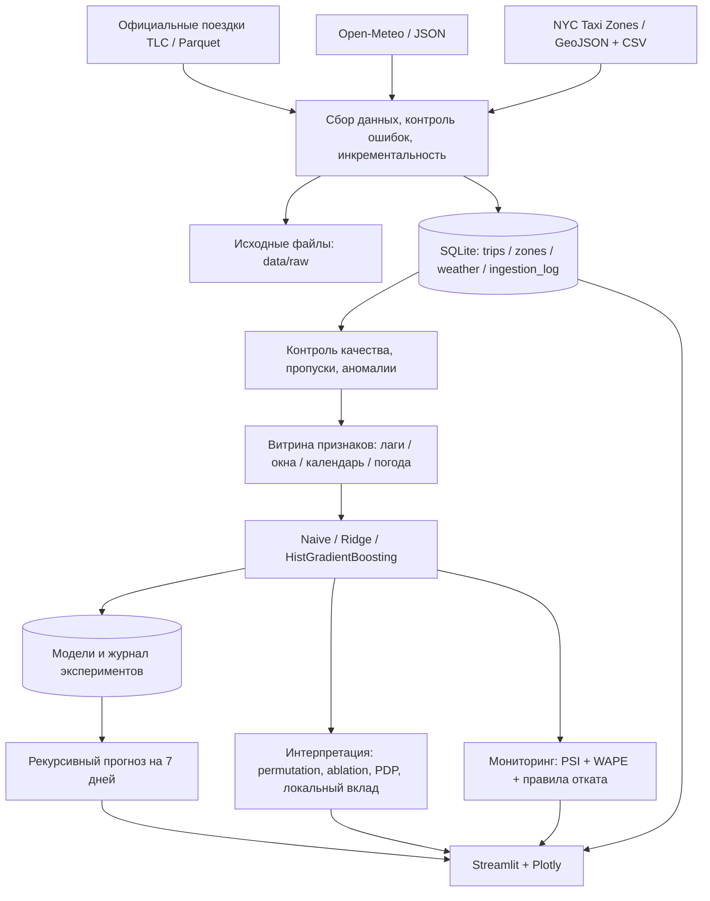

# Архитектура TaxiDemand NYC

Потоки в одной системе, без искусственного создания микросервисов. Формат хранения исходных файлов сохраняется, показатели обрабатываются в SQLite. Признаки во время обучения и прогнозирования формируются одной функцией `build_features`.
